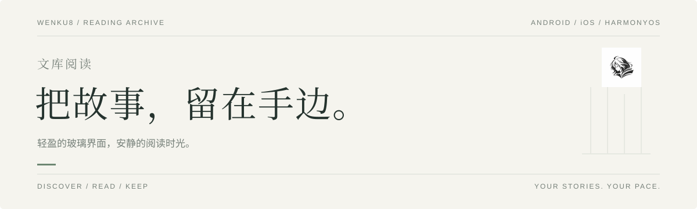

# 文库阅读 · Wenku8 Flutter

<a href="https://afdian.com/a/mikufoxxx">
  <picture>
    <source media="(prefers-color-scheme: dark)" srcset="docs/images/sponsor-zh-dark.svg" />
    
  </picture>
</a>

赞助完全自愿，所有功能仍免费使用。

[上游项目主页 →](https://mikufoxxx.github.io/Wenku8_Flutter/zh.html)

  <picture>
    <source media="(prefers-color-scheme: dark)" srcset="docs/images/readme-cover-dark.svg" />
    
  </picture>

  
  
  
  
  
  
  

奶白玻璃、档案式排版与立体书架。导入自己的书源，发现一本书，整理书库，再进入离线阅读和听书，让每一次打开都回到故事本身。

> [!IMPORTANT]
> **本项目仅为第三方阅读客户端，提供阅读界面与本地书籍管理，不运营在线书库、不自行发布小说资源，安装包不附带小说文件或书源。在线内容及可读状态以 Wenku8 及你导入的书源为准；不提供因版权限制而停止开放的在线书籍阅读。第三方书源由来源方提供，请只导入可信书源。**
>
> **本应用完全免费。** 不出售会员、激活码或功能解锁服务。请勿向以本项目或开发者名义收费解锁功能的第三方付款。
>
> **支持轻小说文库、本地导入与阅读（Legado）格式书源。书源目前仅在 Android 提供，iOS 与 HarmonyOS 支持文库与本地导入。** 支持 Android、iOS 与 HarmonyOS，并非轻小说文库网站的官方应用。

## 界面一览

  
  &nbsp;
  
  &nbsp;
  

发现故事　／　沉浸阅读　／　按习惯定制 界面书目为演示数据

## 用自己的书源发现书籍

- **兼容阅读（Legado）格式，当前仅 Android**：在「我的 → 书源」从文件、剪贴板或 `http`／`https` 链接导入标准书源 JSON（单文件上限 128 MB），支持单个书源、书源数组或 `sources`／`bookSources` 包装对象，最多 10000 个。
- **先选来源，再找书**：发现页列出已导入的书源，选择后可浏览来源自带的分类与榜单，或在来源内搜索。全局搜索会合并文库结果与已启用书源；搜索范围可选全部导入书源、分组或指定书源，只影响导入书源并会记住，不影响文库结果。
- **搜索、详情、目录与正文**：Android 原生引擎解析规则并发起请求，Flutter 侧不重复解释规则；正文支持 `nextContentUrl` 多页拼接，封面和正文插图沿用书源的请求头与 Cookie。
- **管理与换源**：支持按名称、链接、分组搜索，按启用状态或分组筛选，按导入顺序、名称、最近更新或启用状态排序，以及多选启用、停用、删除、导出和分组。在线书籍可跨来源检索同名书籍，可校验作者、按章节数排序，并按章节标题或序号保留阅读进度。
- **规则覆盖**：CSS/jsoup 选择器、JSONPath、XPath、正则与 JavaScript（`@js:`），`url` 选项可通过脚本改写最终请求地址，以及 `{{key}}`、`{{page}}`、`{{baseUrl}}`、请求头、POST 表单／JSON、Cookie 与编码检测。
- **当前限制**：支持文字书源；音频、图片、视频书源会保留在列表中但不执行，下载型文件规则、漫画图片规则与书源调试器尚未接入；登录支持表单和应用内网页登录，弹窗、部分扫码或外部 App 回调仍可能不完整。[书源适配说明 →](docs/BOOK_SOURCES.md)
- **安全边界**：书源规则中的 JavaScript 可以访问 Java 类并发起网络请求，请把书源当作可执行代码，只导入可信来源；用户书源允许 HTTP。

## 阅读，按你的习惯

- **横排、竖排或滚动**：大屏支持对页，曲面纸页随手指翻动、从书缝展开；也可选择段落接续、平移、覆盖或无动画，调整翻页速度。
- **一本书，一套排版**：字体、字号、字重、字间距、行距与四边页边距独立保存；缩进、对齐和背景浓度支持透明预览。
- **让颜色和字形合拍**：系统莫奈、自选主色或图片取色；阅读器独立配色与自定义背景。多款阅读字体按需下载、离线使用、随时删除，不预装阅读字库；也可导入 TTF／OTF，App 与阅读器分别选择。
- **随时找到读到哪里**：分卷目录、本章／整书进度、章内与整书查找、音量键翻页、自动阅读和跨章衔接。封面与插图支持双指缩放及原图保存。
- **双语各取所需**：保留原书浅字样式，按书选择显示语言；朗读语言独立选择，每种语言可单独配置音色，缺少匹配语音模型时跳过。

## 把阅读足迹，留成一张图

- **分清每一种记录**：总览、节律、书目、记号与触摸分类查看，支持预设时间范围与自定义日期；没有数据的字段和图表自动省略。
- **报告不只是换颜色**：八套独立版式，按需选择阅读日历、节律、相伴书单、进度和摘录；预览与导出使用同一份内容。
- **为喜欢的句子留一页**：书签、批注、摘录图片与阅读纪念；四季插图随实际季节切换，保存图片使用短暂提示。

## 桌面上，也有你的阅读日常

今日阅读、本周热力、阅读日历、阅读纪念与摘录卡，搭配四季手帐等五种样式。每张小组件独立选择内容与外观，可同时放置多张；提供小、中、大三种尺寸和浅色／深色模式。

点击统计进入统计页，点击最近阅读继续上次位置，摘录卡可直接换一条。Android 使用应用内配置，iOS 使用系统 WidgetKit 编辑入口，HarmonyOS 使用表单配置。

## 书库，不止一种整理方式

- **立体与列表**：循环轮播、惯性吸附与触觉反馈，也可只用列表。分类、阅读状态和书籍来源一起筛选；本地书库可独立管理，也可与书架合并。
- **先选择，再导入**：支持多选文件、扫描共享存储或指定文件夹；扫描后勾选书籍再导入，同系列分卷统一确认合并。
- **默认关联原文件**：覆盖现有支持格式，也可选择复制到应用；TXT 使用目录索引，EPUB 按需读取资源，其他格式保留必要的转换文件和缓存。请保留关联的原文件；文件移动或权限失效后可重新关联，保留进度和书签。
- **保留原书的细节**：EPUB 注音、注释弹窗、常见对齐、分隔线与混合横竖排；TXT 可自定义目录。在线书籍支持章节与插图缓存，不提供整书文件下载或导出。
- **批量整理，更少重复**：多选后移动分类、移出或删除；更换封面、恢复原书封面，也可手动升级旧 EPUB 排版和整理重复资源，保留原书、目录、进度与书签。

<b>支持的格式与网盘入口</b>

支持 TXT、EPUB、MOBI／AZW／AZW3／PRC、FB2、PDF、DOC／DOCX、RTF、HTML、Markdown 与 ZIP。书名、作者、封面和分卷顺序可调整。

可通过 OpenList／WebDAV、夸克网盘（实验性）导入；OneDrive、Google Drive 等可使用系统云文档入口，手动合并同步原书与阅读记录。

[网盘导入指南 →](docs/CLOUD_IMPORT.md)

## 读到哪里，都能接着读

- **局域网续读**：同一 Wi-Fi 自动发现，首次两端确认后自动重连。在「目录 → 章节进度 → 在其他设备上续读」选择设备，缺书时一并传送，已有同一本书时只传位置。
- **S3 云端同步**：通过 S3／兼容存储手动合并原书、阅读进度、书签与分类；导入连接和同步目的地分别设置。
- **离线查词**：导入 MDict、StarDict 或 Kindle 词典，在阅读时本地查词。
- **书签与分类同步**：两台 App 保持前台时自动接续较新的进度，增量同步书签和分类；同时修改的记录可在冲突页选择保留。
- **留下喜欢的句子**：长按正文选句或段落，复制、加入书签或快速查看本卷插图。书签可分类、定位高亮，也可分享成带图标水印的图片。
- **换一种方式听故事**：自然在线音色、自定义 Microsoft SSML 接口，或手机已安装的系统 TTS 引擎。支持 0.5～3 倍速、段落跟随、睡眠定时、后台与锁屏控制；离线能力取决于引擎和音色。

<b>更多：发现与阅读偏好</b>

- **书籍发现**：在发现页选择书源后浏览来源自带的分类与榜单，按书名、作者或标签搜索文库及已启用书源；点作者或标签继续浏览相关作品。[搜索指南 →](docs/SEARCH.md)
- **阅读操作**：分区点按可选左右两侧都翻下一页；发现、书架和本地页可分别设置点书直接续读，再从阅读器进入详情。
- **离线与备份**：失败续缓存、缓存管理、阅读历史与本地备份。
- **主题图标**：桌面图标可跟随系统主题取色，开关独立控制。
- **中文支持**：简体中文、香港繁体与台湾繁体，可跟随系统或手动选择。
- **使用方式**：可在 App 内强制竖屏，不影响其他应用旋转；无网时保留可离线阅读的书，阅读器模式随本地／合并书架设置联动。
- **性能与动效**：帧率偏好和低性能模式，玻璃折射、模糊、过渡、动态图标与立体书架可分别调整；振动支持总开关，以及按钮、书架等分类开关、强度与试振。

## 使用与内容说明

在线书目与内容来自轻小说文库（Wenku8）及你导入的书源，本地书籍由用户自行导入。小说、封面和插图归各自权利人所有，源码许可不授予内容使用权。请仅使用有权访问的内容，遵守各来源网站规则，不得绕过访问限制、破解 DRM，或未经许可复制、传播、出售内容。书源是可执行规则而非纯数据，启用前请确认它能够访问的内容。

第三方服务可能调整、限流或停止。反馈问题时不要附带密码、Cookie 或令牌。

## 开发与参与

欢迎通过 Pull Request 参与开发；问题反馈可前往[上游 Issues](https://github.com/mikufoxxx/Wenku8_Flutter/issues)（本仓库未开启 Issues）。反馈请附 App 版本、设备与系统版本和复现步骤。

<b>源码快照说明</b>

仓库提供部分实现供参考，包含未随快照提供的模块引用，不能独立构建，也不是 Release 安装包的完整对应源码。上游此前发行的安装包为完整功能版本；本仓库已发布 Android Release，GitHub 自动生成的 Source code 压缩包不是安装包。

[Source checks](https://github.com/XiaoMing-Brother/Wenku8_Flutter_legado/actions/workflows/flutter-ci.yml) 仅检查公开文件清单与上传边界，不构建或更改发行版。

[构建指南 →](docs/RELEASING.md)

## 致谢与许可

感谢以下项目与贡献者。它们分别提供了产品方向、规则语义、交互参考或可复用组件；名称、代码与内容版权归各自作者所有。

**原项目与参考实现**
- [mikufoxxx/Wenku8_Flutter](https://github.com/mikufoxxx/Wenku8_Flutter)：原轻小说文库 Android 客户端，本项目的基座，主要是在该项目上添加的一系列功能。
- [MewX/light-novel-library_Wenku8_Android](https://github.com/MewX/light-novel-library_Wenku8_Android)：原轻小说文库 Android 客户端，本项目的产品方向与功能参考。
- [gedoor/legado](https://github.com/gedoor/legado)：阅读（Legado）书源规则体系的原始项目，本项目兼容其文字书源规则。
- [HapeLee/legado-with-MD3](https://github.com/HapeLee/legado-with-MD3)：Legado 的 MD3 分支，书源规则语义与交互实现参考。
- [DandanLLab/mr](https://github.com/DandanLLab/mr)：Flutter 多媒体阅读器，阅读器、EPUB 与书源适配的实现参考。

书源兼容为规则语义层面的独立实现，不包含 Legado 应用源码。

**组件与许可**
- **公开源码**：沿用仓库既有 [LICENSE](LICENSE) 与 [GPL v3 声明](assets/licenses/GPL-3.0.txt)。
- **可下载字体**：遵循各自的 SIL OFL 1.1 许可。
- **在线语音适配**：[rany2/edge-tts](https://github.com/rany2/edge-tts)，[LGPL v3](assets/licenses/edge-tts.txt)。
- **书源引擎**：[OkHttp 4.12.0](https://square.github.io/okhttp/)（Apache-2.0）、[JsonPath 2.9.0](https://github.com/json-path/JsonPath)（Apache-2.0）与 [Rhino 1.8.1](https://github.com/mozilla/rhino)（MPL-2.0），详见[第三方组件说明](docs/THIRD_PARTY.md)。

[NOTICE](NOTICE) · [第三方组件说明](docs/THIRD_PARTY.md) · [LINUX DO 社区](https://linux.do/)

## 上游项目 Star History

<a href="https://www.star-history.com/?repos=mikufoxxx%2Fwenku8_flutter&type=date&releases=&legend=bottom-right">
  <picture>
    <source media="(prefers-color-scheme: dark)" srcset="https://api.star-history.com/chart?repos=mikufoxxx/wenku8_flutter&type=date&theme=dark&legend=top-left" />
    <source media="(prefers-color-scheme: light)" srcset="https://api.star-history.com/chart?repos=mikufoxxx/wenku8_flutter&type=date&legend=top-left" />
    
  </picture>
</a>
